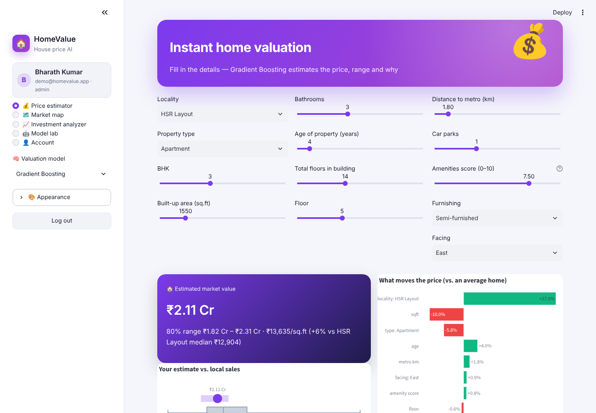
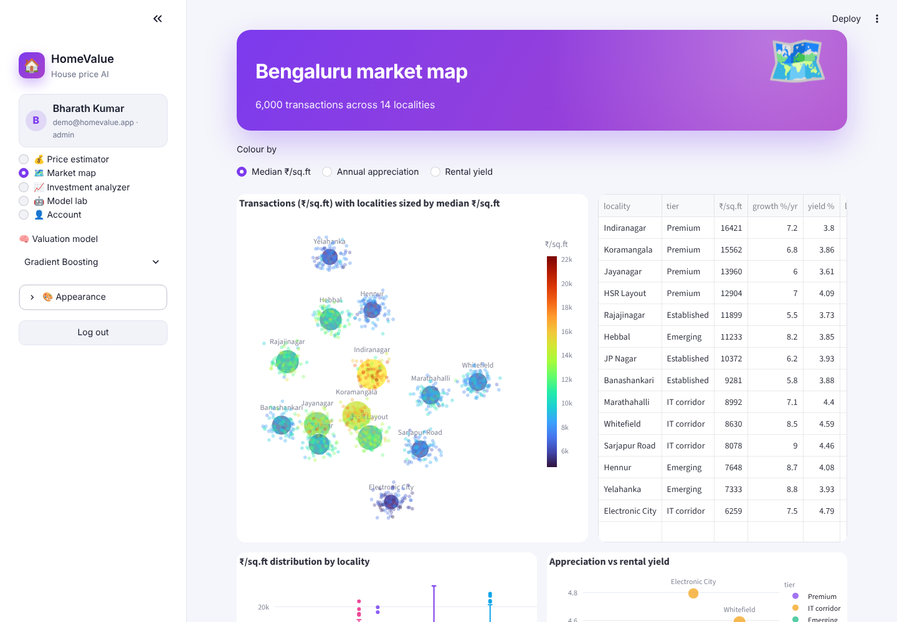
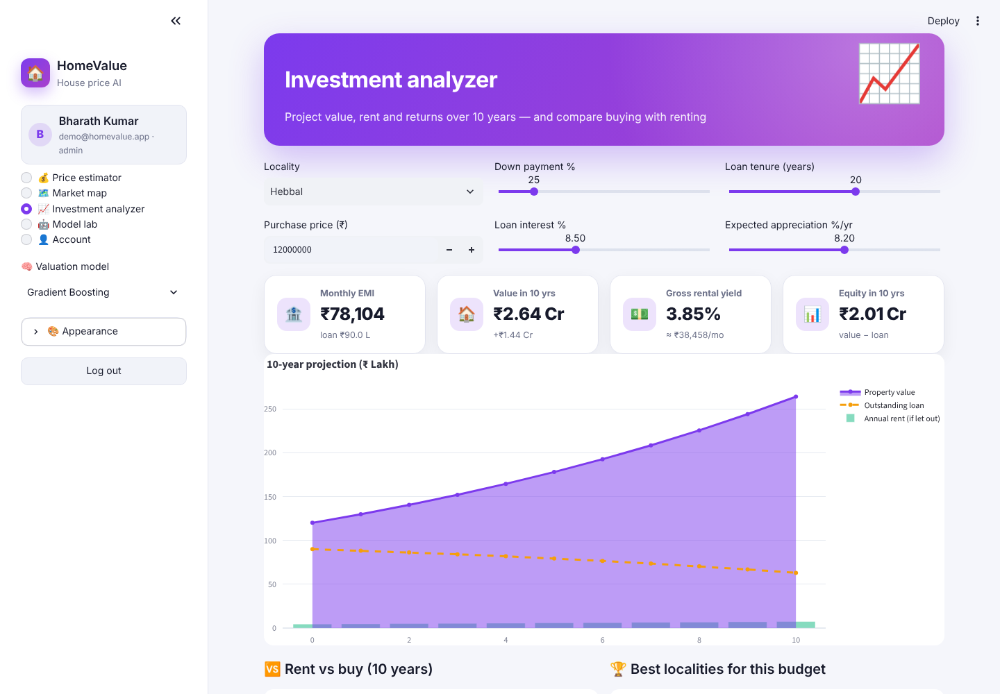
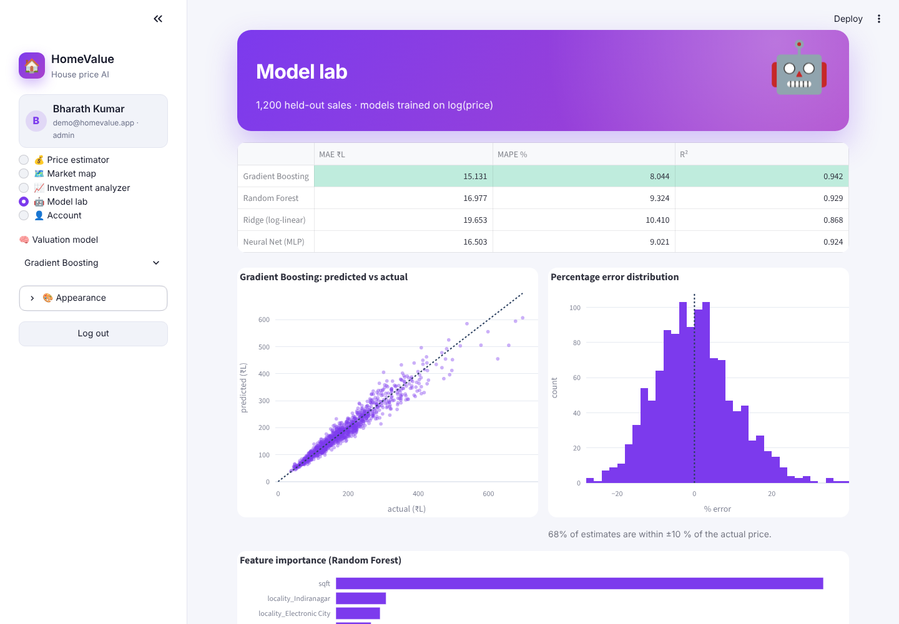

<div align="center">

# 🏠 HomeValue — AI House Price Prediction

**Instant AI valuations for Bengaluru homes — price with an 80 % range, comparable sales, the factors behind every estimate, a locality market map and a 10-year investment analyzer**


</div>

## ✨ Features

| Page | What it does |
|---|---|
| 🔐 **Register / login** | SQLite users with salted **PBKDF2-SHA256** hashing, password-strength meter, roles (buyer, seller, agent, investor), demo account, change password |
| 💰 **Price estimator** | 13 inputs (locality, type, BHK, area, baths, age, floors, metro distance, parking, amenities, furnishing, facing) → value, **80 % range from quantile regression**, ₹/sq.ft vs locality median, estimate vs local-sales box plot, **% effect of each factor**, **6 comparable sales** (k-NN), EMI, expected rent, 5-year value, stamp duty, downloadable valuation report |
| 🗺️ **Market map** | 1,500 transactions coloured by ₹/sq.ft with locality bubbles sized by price, appreciation or rental yield; locality table; ₹/sq.ft box plots; appreciation-vs-yield bubble chart |
| 📈 **Investment analyzer** | Down payment, rate, tenure and growth sliders → EMI, 10-year value / loan / rent projection, equity, **rent-vs-buy comparison**, best localities for your budget |
| 🤖 **Model lab** | Gradient Boosting vs Random Forest vs Ridge (log-linear) vs **MLP neural net** — MAE, MAPE, R², predicted-vs-actual, % error histogram, feature importance |
| 🎨 **Themes** | Light · Dark · Midnight · Sepia · Forest, 6 accents, animation toggle |

## 🧠 How it works

* **Data** – 6,000 simulated sales across 14 Bengaluru localities (Indiranagar to Electronic City) with locality base prices, premiums for villas, furnishing and NE/East facing, discounts for age and metro distance, size effects and log-normal noise.
* **Target** – models learn `log(price)` so errors are proportional; MAPE ≈ 8 % for Gradient Boosting.
* **Range** – two quantile Gradient Boosting models (10th and 90th percentiles).
* **Explanation** – ridge coefficients on standardised / one-hot features, shown as % effect versus an average home.
* **Comparables** – nearest neighbours in the same transformed feature space.

## 🖼️ Screenshots

| Price estimator | Market map |
|---|---|
|  |  |
| **Investment analyzer** | **Model lab** |
|  |  |

## 🚀 Run it

```bash
git clone https://github.com/PreciousBharath/HOMEVALUE-AI-HOUSE-PRICE-PREDICTION.git
cd HOMEVALUE-AI-HOUSE-PRICE-PREDICTION
pip install -r requirements.txt
streamlit run app.py
```

Click **⚡ Demo account** (`demo@homevalue.app` / `Demo@1234`) or register. The first run trains the models (~20 s), then they are cached.

## 📁 Project structure

```
app.py      # Streamlit UI — 5 pages
model.py    # market simulation, 4 regressors + quantile models, comparables, explanations, EMI
auth.py     # SQLite users + PBKDF2 hashing + login/register UI
theme.py    # 5 themes, accents, animated CSS, Plotly template
ui.py       # hero, KPI and result-card components
```

> Estimates are for learning purposes — use a registered valuer for real transactions.

## 📄 License

MIT © Bharath
